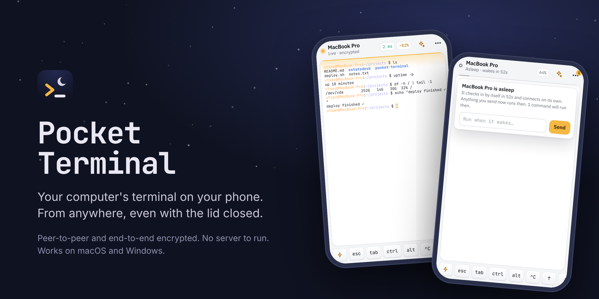
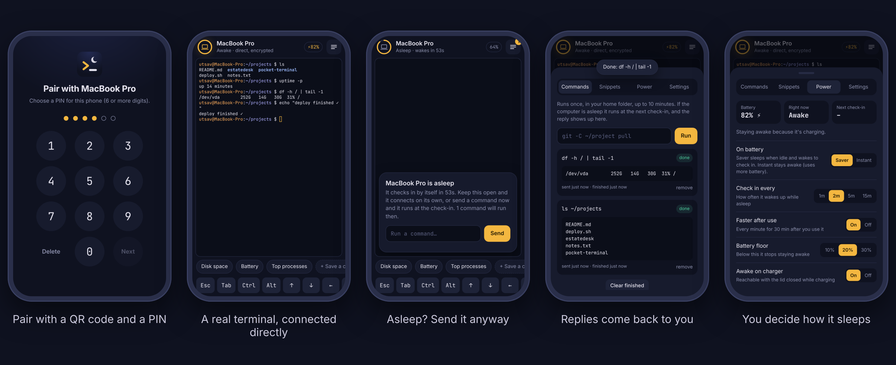
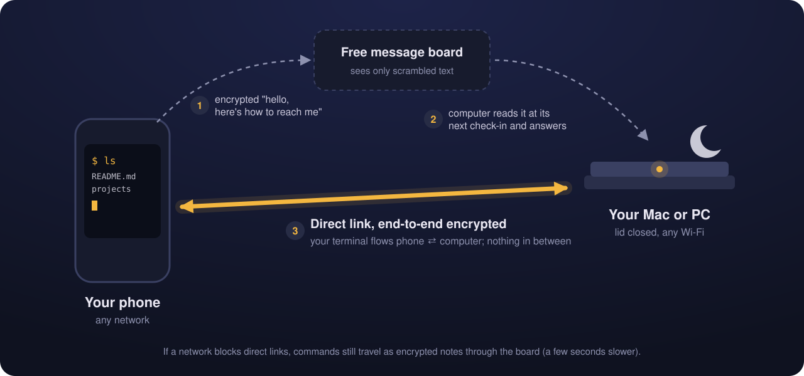
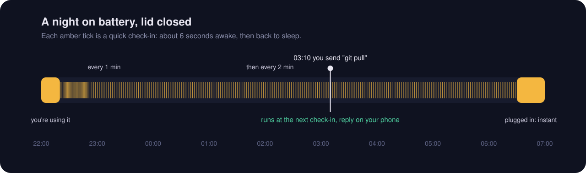
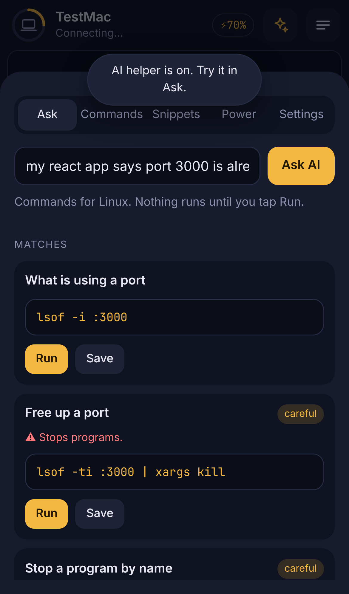

<p align="center">
  
</p>

<p align="center">
  <a href="LICENSE"></a>
  
  
  
</p>

<p align="center">
  <a href="#-quick-start">Quick start</a> ·
  <a href="#-how-it-works">How it works</a> ·
  <a href="#-lid-closed-battery-safe">Lid closed</a> ·
  <a href="#-forgot-the-command-just-ask">Ask</a> ·
  <a href="#-security">Security</a> ·
  <a href="#-faq">FAQ</a>
</p>

---

You're out, your laptop is in your bag with the lid shut, and you need to run *one* command on it.
Restart a server, pull the latest code, check if a job finished.

**Pocket Terminal** lets you do that from your phone. Your phone and your computer connect
**directly to each other**, everything is **end-to-end encrypted**, and there's **no server for
you to run or pay for**. When the computer is asleep, it wakes itself every minute or two to check
for your commands, then goes back to sleep.

<p align="center">
  
</p>

## ✨ What you get

| | |
|---|---|
| 🖥️ **A real terminal** | zsh, bash or PowerShell with colours, tab completion, and Ctrl/Esc/arrow keys on a touch keyboard bar. |
| 🌍 **Any network** | Phone on mobile data, computer on any Wi-Fi. No router settings, no port forwarding. |
| 🌙 **Works with the lid closed** | On charger it answers instantly. On battery it sleeps and checks in every 1–2 minutes. |
| 🔐 **End-to-end encrypted** | A key only your devices have. Nothing in the middle can read a single character. |
| ✦ **Ask in plain English** | "My app says port 3000 is in use" → the right command for your Mac or Windows PC, explained, ready to run. |
| 🔎 **Half-remember a command?** | Type `git sta` or "big files" and pick from 70+ built-in commands, your saved ones and your history. Works offline. |
| ⚡ **One-tap commands** | Save your common commands as chips above the keyboard. |
| 📬 **Send now, runs later** | Computer asleep? Send the command anyway; the reply comes back to your phone. |
| 🔋 **Battery-safe** | It never stays awake below 20% battery and stops waking below 10%. |
| 🛡️ **Only phones you approve** | Each QR code works once. The computer shows a 6-digit code and you type `y`. Remove any phone later. |
| 📱 **Feels like an app** | PIN lock, home-screen install, works on iPhone and Android. |

## 🧭 How it works

<p align="center">
  
</p>

1. **Pairing (once per phone).** Your computer shows a one-time QR code. Your phone scans it and both
   screens show the same 6-digit code; you type `y` on the computer. The computer then gives that phone
   its own secret key, sent wrapped with a fresh key exchange (ECDH), so even someone who photographed
   the QR code can't read it. The QR code is then dead.
2. **Finding each other.** Both use a free public message board ([ntfy.sh](https://ntfy.sh)) as a
   private mailbox. The mailbox name and every note in it are scrambled with your key.
3. **Direct link.** The phone leaves a note saying "here's how to reach me", the computer answers,
   and both knock on each other at the same moment. Routers let that through. It's the same trick
   video calls use. From then on your terminal flows **straight between your devices**.

If a strict network blocks direct links, commands still travel as encrypted notes through the board.
That's a few seconds slower, but it works anywhere normal web browsing works.

## 🌙 Lid closed, battery safe

<p align="center">
  
</p>

A small "power brain" on your computer decides when to stay awake:

| Your computer is… | Your command runs |
|---|---|
| Plugged in, lid closed | **Instantly** |
| On battery, you used it in the last 30 min | Within **~1 minute** |
| On battery, idle for hours | Within **~2 minutes** (set 1 min if you like) |
| On battery with *Instant* mode on | **Instantly** (uses more battery) |
| Below 10% battery | Waits until you charge |

Each check-in keeps the computer awake for about 6 seconds, so frequent check-ins stay cheap.
You can change all of this from the phone: **☰ → Power**.

## ✦ Forgot the command? Just ask



Tap **✦** and type what you want, either in plain English or the bit of the command you remember.

- **Built-in finder (free, offline).** 70+ everyday commands for macOS, Windows and Linux, plus your
  saved commands and the ones you ran before. Type `docker`, `git sta` or "free up port 3000" and the
  matches appear as you type, with obvious blanks already filled in (`3000`, `~/Downloads`).
- **AI helper (optional), any model you like.** Anything the finder doesn't know goes to an AI with
  **your own key**: ChatGPT models (OpenAI), Claude (Anthropic), Gemini, Groq, Mistral, DeepSeek, Grok,
  [OpenRouter](https://openrouter.ai/keys) (one key for all of them), or **any OpenAI-compatible API** via
  *Custom*. [Groq](https://console.groq.com/keys) and [Gemini](https://aistudio.google.com/apikey) keys are free.
  It knows whether your computer runs zsh or PowerShell. A **Test** button checks your key.
- **✦ Fix with AI.** When a command fails, tap *Fix with AI* in **Commands**. It sends that command and
  the end of its output, and you get back what went wrong and the command to run instead.
- **Nothing runs by itself.** You see each command, a one-line explanation and a
  <code>safe</code> / <code>careful</code> / <code>danger</code> label. The app checks every command itself
  as well, so it doesn't just trust the AI. Danger needs a second tap. You can edit any command
  before you run it.
- **Private.** The key is stored encrypted on your phone. Only the sentence you type goes to the AI,
  straight from your phone. Your files, command output and computer never do.

Set it up in **☰ → Settings → AI helper**.

<br clear="right">

## 🚀 Quick start

You need a **Mac or a Windows 10/11 PC** with [Node.js 18.20+](https://nodejs.org), and a phone.
It takes about 5 minutes.

### 1. The phone app
The app lives at **[utsavdoye20122005.github.io/pocket-terminal](https://utsavdoye20122005.github.io/pocket-terminal/)**. Nothing to do here:
the installer uses it automatically.

> **Want your own copy instead?** The app's code is what handles your key, so the most careful setup is
> your own: click **Fork**, then in your fork go to **Settings → Pages → Deploy from a branch**, branch
> `main`, folder `/docs`. The installer notices the fork and uses `https://<you>.github.io/pocket-terminal/`.
> See [SECURITY.md](SECURITY.md).

### 2. Install on your computer

<table>
<tr><th>macOS (Terminal)</th><th>Windows (PowerShell, no admin needed)</th></tr>
<tr><td>

```bash
git clone https://github.com/<you>/pocket-terminal.git
cd pocket-terminal/agent
bash install.sh
```

</td><td>

```powershell
git clone https://github.com/<you>/pocket-terminal.git
cd pocket-terminal\agent
powershell -ExecutionPolicy Bypass -File install.ps1
```

</td></tr>
<tr><td>Asks for your Mac password once (to manage sleep).</td><td>Starts at every sign-in, hidden.</td></tr>
</table>

Both end by showing a **one-time QR code**.

### 3. Pair your phone
1. Open the app link on your phone and install it: **Share → Add to Home Screen** (iPhone) or **⋮ → Install app** (Android).
2. Open **Pocket Terminal** from your home screen and tap **Scan QR code**. Or tap **Paste pairing link** and paste the link `pair.js` prints.
3. Your phone and computer show the same 6-digit code. If they match, type **y** on the computer.
4. Choose a PIN on the phone.

> **iPhone:** install first, then pair *inside* the home-screen app. iPhone keeps home-screen apps separate
> from Safari, so a pairing made in Safari doesn't carry over. The app reminds you if you open the link in Safari.

That's it. Open the app and you'll see your computer **awake, connected directly**.

## 🧰 Everyday use

| I want to… | Do this |
|---|---|
| Run something quickly | Tap a saved-command chip, or type in the terminal |
| Find a command I half-remember | Tap **✦**, type what you remember |
| Turn English into a command | Tap **✦**, type it, tap **Ask AI** (needs a key in Settings) |
| Save a command | Tap **+ Save a command**, or **Save** on any suggestion |
| Run something while it sleeps | Type it in the "asleep" card; the reply shows in **☰ → Commands** |
| Get a ping when it finishes | Install the free [ntfy app](https://ntfy.sh) and subscribe to the topic in **☰ → Settings** |
| Pair another phone | `node pair.js` (in the `agent` folder), a fresh one-time QR code |
| See which phones can connect | `node pair.js --list` |
| Lock one phone out | `node pair.js --remove "iPhone (Safari)"` (or `--remove all`). Works within seconds |
| See what it's doing | `tail -f ~/.pocket-terminal/agent.log` |
| Uninstall | `bash uninstall.sh` (Mac) · `uninstall.ps1` (Windows); add `--purge` / `-Purge` to delete the key |

## 🔐 Security

- **End-to-end encrypted:** AES-256-GCM for notes, DTLS for the direct link. The link's fingerprints
  are exchanged inside the authenticated notes, so nobody can sit in the middle.
- **Private by design:** the message board and STUN servers see only scrambled text and IP addresses.
  Command text is never written to logs. Notifications never contain your commands.
- **Only approved phones:** a QR code works once, for 10 minutes, and only after you type `y` on the
  computer next to a matching 6-digit code. If two phones try the same code, both are refused.
  Every phone has its own key, so you can remove one without touching the others.
- **Locked phone:** your key is stored encrypted with your PIN, and 10 wrong tries wipe it.
- **AI is opt-in:** off until you add your own key. It only sees what you type in Ask, and never runs
  anything without your tap.
- **Minimal rights:** on Mac it can run exactly four `pmset` sleep commands; on Windows it needs no admin.

Read [SECURITY.md](SECURITY.md) for the full threat model, including what it **doesn't** protect against.

## ⚖️ Honest limits

- **The computer must be on and online.** Asleep is fine. Shut down or out of battery is not.
- **The message board is a free public service.** It only carries the encrypted hellos and backup
  commands, never your live terminal. It has a daily limit that's plenty for personal use. For heavy
  use, add your own board (see Advanced).
- **Some strict networks block direct links.** Then you get the slower backup route.
- **Windows support is newer (beta).** Windows can't report whether the lid is closed, so on battery
  it only sleeps after 10 minutes without keyboard or mouse use. Laptops with "Modern Standby" may
  ignore wake-up alarms on battery. The installer tells you; use Instant mode or keep it plugged in.
- **Quick check-ins need Wi-Fi to reconnect during a silent wake-up.** Most computers do this. If yours
  doesn't, use Instant mode on battery.

## ❓ FAQ

<details><summary><b>Is there really no server?</b></summary>

There's no server **you** run, and none that can read your data. Two devices on different networks
can't find each other without *some* public meeting point, so a free message board passes a few
encrypted "hello" notes. Your live terminal never goes through it.
</details>

<details><summary><b>How is this different from SSH, Tailscale or Claude Code's remote control?</b></summary>

Those assume your computer is awake. Pocket Terminal is built around a computer that's **asleep in your
bag**: it wakes itself briefly to check for work, runs it, replies, and sleeps again. And there's
nothing to configure on your router or account to sign up for.
</details>

<details><summary><b>What does it cost in battery?</b></summary>

Each check-in is about 6 seconds awake. With the defaults, my rough estimate is a few percent overnight.
Your real numbers are in the log.
</details>

<details><summary><b>Can someone else control my computer?</b></summary>

Only a phone you approved on the computer itself. A QR code works once, so a photo of it is useless
afterwards, and a second phone trying the same code cancels the pairing. Lost a phone? Run
`node pair.js --remove "<its name>"` and it is locked out within seconds.
</details>

<details><summary><b>Does it work on Linux?</b></summary>

The agent runs on Linux (great for servers): live terminal and commands, without the sleep features.
</details>

## 🛠️ Advanced

- **Your own message board:** run [ntfy](https://docs.ntfy.sh/install/) anywhere, then
  `node pair.js --board https://ntfy.example.com` and re-pair. List several boards; if one is down,
  the others still work.
- **TURN server** for networks that block all direct links: add it to
  `~/.pocket-terminal/direct.json` → `"iceServers": ["stun:stun.l.google.com:19302", "turn:user:pass@host:3478"]`.
- **Different shell on Windows:** set `POCKET_SHELL` to `pwsh.exe` or `cmd.exe`.
- **Relay mode** (an always-on server in the middle): see [`relay/`](relay/).

## 🗂️ Project layout

```
agent/            runs on your computer
  agent.js          starts everything
  direct.js         direct link + encrypted mailbox (WebRTC via node-datachannel)
  power.js          the power brain: when to stay awake, when to sleep
  platform/         sleep/wake switches for macOS and Windows
  lib/              encryption (HKDF + AES-256-GCM), message board, terminal
  pair.js           one-time pairing QR + approve / list / remove phones
  devices.js        one private mailbox per paired phone
  install.sh / install.ps1
docs/             the phone app: static files served by GitHub Pages
  js/helper.js      Ask: built-in command finder, safety check, AI providers
test/             offline tests: fake board, fake sleeping computer, real WebRTC in a browser
relay/            optional self-hosted relay
```

## 🧪 Tests

```bash
cd agent && npm test        # power brain, Windows parsers, encryption, message boards
python3 test/e2e_direct.py  # full run: phone app in a headless browser ⇄ agent, with a sleeping computer
python3 test/e2e_ask.py     # Ask: finder, AI (fake provider), danger checks, key encryption, Fix with AI
python3 test/e2e_pairing.py # one-time QR, approval code, reused QR, two phones racing, removing a phone
python3 test/e2e_scan.py    # iPhone home-screen app: scan the QR with the camera, or paste the link
python3 test/e2e_autoconnect.py # the Mac falls asleep on its own; the app reconnects by itself when it wakes
```

The end-to-end test pairs a phone, opens the direct link, runs commands, puts the computer to sleep,
sends a command, wakes it, checks the reply, tests the backup route, and confirms the board never saw
any readable text.

## 📄 License

[MIT](LICENSE). Built by [Utsav Doye](https://github.com/UtsavDoye20122005).
If this saved you a trip back to your laptop, a ⭐ helps others find it.
