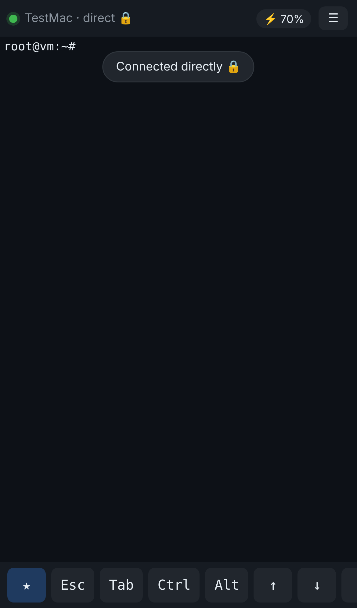
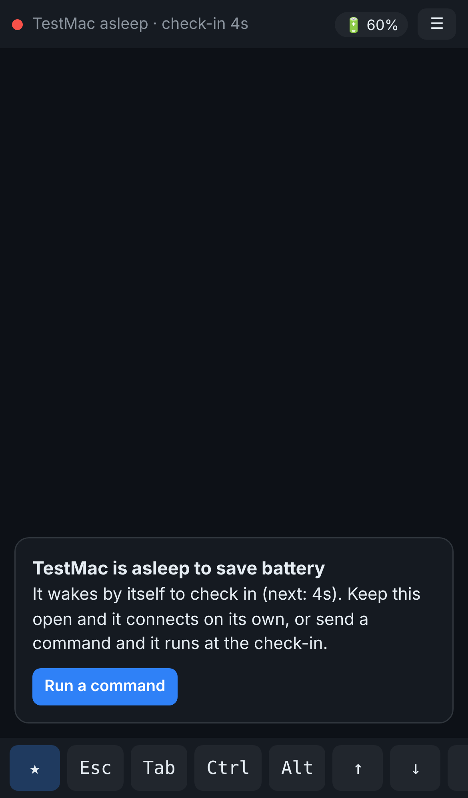
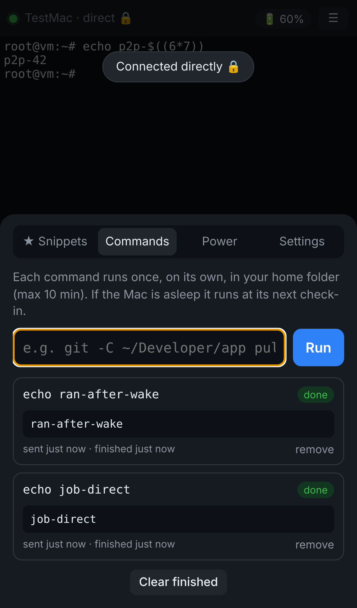

# 📱 Pocket Terminal

**Your Mac's terminal on your phone, from anywhere, even with the lid closed.**
Phone and Mac connect **directly** (peer-to-peer) and everything is **end-to-end encrypted**.
No server to host, no account, no subscription. Free.

```
📱 phone  ══════ direct, encrypted (WebRTC) ══════  💻 Mac, lid closed
     ╲                                               ╱
      ╲── one encrypted "hello" via a free board ───╱   (only to find each other)
```

<p align="center">
  
  
  
</p>

- **Live terminal**: real zsh, colours, Ctrl/Esc/arrow keys, tab completion.
- **Any network**: phone on mobile data, Mac on any Wi-Fi. No router settings.
- **Lid closed**: on charger it's instant. On battery the Mac sleeps and wakes every
  1–5 minutes to run what you sent. Battery use stays close to normal sleep.
- **End-to-end encrypted**: the board in the middle only ever sees scrambled text.
- **★ Snippets**: one-tap saved commands.
- **Commands while away**: send a command, get the output back, even if the Mac was asleep.
- **Battery-safe**: it never stays awake below 20% and stops waking below 10%.
- **PIN-locked phone app**: installs to your home screen like a normal app.

---

## How it works (simple version)

1. **Pairing (once):** your Mac makes a secret key and shows it as a QR code. Your phone scans
   it. Now both have the same key. Nobody else ever sees it.
2. **Finding each other:** both devices use a free public message board
   ([ntfy.sh](https://ntfy.sh)) as a mailbox. The mailbox name and every note in it are
   derived from your key and encrypted with it, so to anyone else it's random gibberish.
3. **Direct link:** the phone posts "here's how to reach me", the Mac replies with its own
   details, and both knock on each other at the same moment. Routers let that through
   ("hole punching", the same trick video calls use). From then on, everything goes
   **straight phone ⇄ Mac**.
4. **If a network blocks direct links:** commands still work as encrypted notes through the board.
   That's a few seconds slower, but it works anywhere normal browsing works.
5. **Lid closed:** a small "power brain" keeps the Mac awake on charger. On battery it lets the
   Mac sleep, sets a wake-up alarm, checks the mailbox for a few seconds, then sleeps again.

## Quick start (about 5 minutes)

**You need:** a Mac (Apple Silicon or Intel) with [Node.js 18.20+](https://nodejs.org), and an
iPhone or Android phone.

**1. Fork this repo and turn on GitHub Pages** (your own copy of the phone app; see why in [SECURITY.md](SECURITY.md))
- Click **Fork** on GitHub.
- In your fork: **Settings → Pages → Build and deployment → Deploy from a branch →**
  Branch **main**, folder **/docs** → **Save**.
- After about a minute, your app is live at `https://<your-username>.github.io/pocket-terminal/`.

**2. Install on your Mac** (Terminal):
```bash
git clone https://github.com/<your-username>/pocket-terminal.git
cd pocket-terminal/agent && bash install.sh
```
It asks for your Mac password **once** (so it can manage sleep), then shows a **QR code**.

**3. Pair your phone**
- Scan the QR code with your phone's camera.
- Choose an app **PIN**.
- Tap **Share → Add to Home Screen**.

**4. Use it.** Open the app and you'll see `● YourMac · direct 🔒`. Type away.

## Lid closed and battery

| Mac state | Your command runs |
|---|---|
| On charger, lid closed | **Instantly** |
| On battery, you used it in the last 30 min | Within **~1 min** |
| On battery, idle for hours | Within **~5 min** (adjustable) |
| On battery, *Instant* mode on | **Instantly** (uses more battery) |
| Battery below 10% | Waits until you charge |

Change all of this in the app: **☰ → Power**. Each quick check-in keeps the Mac awake about
6 seconds. My rough estimate is a few percent of battery overnight. Check
`~/.pocket-terminal/agent.log` for your real numbers.

## Honest limits

- **The Mac must be on and online.** It can be asleep, just not shut down and not out of battery.
- **The message board is a free public service** ([ntfy.sh](https://ntfy.sh)). It only carries
  the encrypted "hellos" and backup commands, never your live terminal. It has a free daily
  message limit, which is plenty for normal use. For heavy use, add your own board (see Advanced).
- **Some strict networks block direct links** (some offices, some mobile carriers on IPv4).
  Then you get the backup route: commands work, the live terminal doesn't.
- **Mac only** for now. The phone side is any modern browser.
- **Quick check-ins with the lid closed need Wi-Fi to reconnect during a "dark wake".** Most Macs do
  this. If yours doesn't, use Instant mode on battery, or keep it on charger.

## Notifications (optional)
Install the free **ntfy** app ([iOS](https://apps.apple.com/app/ntfy/id1625396347) /
[Android](https://play.google.com/store/apps/details?id=io.heckel.ntfy)) and subscribe to the
topic shown in **☰ → Settings → Notifications**. You'll get "Command finished ✅" pings
(content-free: never your command or output).

## Everyday commands (on the Mac)

| What | Command (inside `pocket-terminal/agent`) |
|---|---|
| Show the QR code again | `node pair.js` |
| Lock out every paired phone (new key) | `node pair.js --new` then restart the agent |
| Restart the agent | `launchctl kickstart -k gui/$(id -u)/com.pocketterminal.agent` |
| See the log | `tail -f ~/.pocket-terminal/agent.log` |
| Uninstall | `bash uninstall.sh` (add `--purge` to delete the key) |

## Advanced
- **Your own message board** (no shared service at all): run [ntfy](https://docs.ntfy.sh/install/)
  anywhere, then `node pair.js --board https://ntfy.your-domain.com` and re-pair. You can list
  several boards: notes go to all of them, so if one is down the others still work.
- **TURN server** for networks that block all direct links: add it to `~/.pocket-terminal/direct.json`
  as `"iceServers": ["stun:stun.l.google.com:19302", "turn:user:pass@your.turn.host:3478"]`.
- **Relay mode** (always-on server in the middle, web-push notifications): see [`relay/`](relay/).

## Project layout
```
agent/            runs on your Mac
  agent.js          starts everything
  direct.js         P2P link + encrypted mailbox (WebRTC via node-datachannel)
  power.js          the power brain (lid-closed + battery rules)
  lib/crypto.js     end-to-end encryption (HKDF + AES-256-GCM)
  lib/board.js      message-board client (ntfy protocol)
  lib/core.js       the terminal + one-off commands
  pair.js           pairing QR code
  install.sh        one-command setup
docs/             the phone app (static files, served by GitHub Pages)
relay/            optional self-hosted relay (advanced)
test/             offline tests: fake board, fake Mac, real WebRTC in a browser
```

## Tests
```bash
cd agent && npm test     # power brain + encryption + boards
```
The full end-to-end test (`test/`) runs a fake message board, the real phone app in a headless
browser, and the Mac agent with a simulated sleeping Mac.

## Security
Short version: everything is end-to-end encrypted with a key only your devices have, the
direct link is authenticated by that key, and the phone app is PIN-locked. Read
[SECURITY.md](SECURITY.md) for the full threat model and what it does **not** protect against.

## License
MIT. Built by [Utsav Doye](https://github.com/UtsavDoye20122005).
